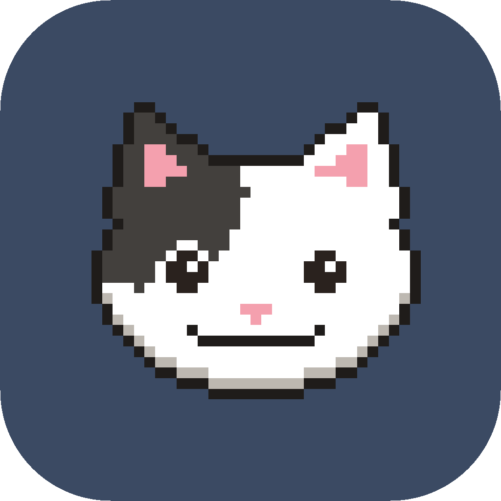
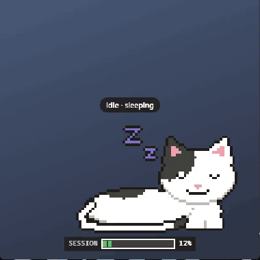

<p align="center"></p>

<h1 align="center">AgentPet</h1>

<p align="center">
  <b>A desktop pet that babysits your AI coding agent.</b><br>
  Noodle sleeps while Claude Code is idle, works while it works, <b>hops and meows when it needs
  your approval</b> (approve right from his bubble), and farts a rainbow when the task is done. 🌈
</p>

<p align="center">
  <a href="#install">Download</a> ·
  <a href="#what-noodle-does">Features</a> ·
  <a href="#how-it-works">How it works</a> ·
  <a href="#privacy">Privacy</a> ·
  <a href="#development">Development</a>
</p>

<p align="center">
  
  
</p>

<p align="center"></p>

## Why

Your agent runs for minutes at a time, then quietly stops to ask for a permission while you're in
another window. Noodle floats above everything, so you see at a glance whether Claude is working,
done, or waiting for you, and you can say yes without going back to the terminal.

## What Noodle does

| Mood      | When                                                                         | Noodle                                        |
| --------- | ---------------------------------------------------------------------------- | --------------------------------------------- |
| sleeping  | agent idle                                                                   | lies down, tail wrapped around him            |
| working   | agent working                                                                | tail holds a coffee mug                       |
| **needs** | **waiting for your approval**                                                | meows, hops toward you, Approve / Deny bubble |
| happy     | task done                                                                    | tail draws a heart, rainbow fart              |
| sweat     | session usage passes 50 / 80 / 95 %                                          | holds a coin, sweats                          |
| sad       | the agent hit an error                                                       | lies flat, tears                              |
| hiss      | risky action: `.env`, `rm -rf`, `git push --force`, deleted tests, 25+ files | puffed tail, says why                         |

### Stay in flow

- **✅ Approve / Deny from the pet**: no trip back to the terminal for every permission.
  Not sure? "Answer in terminal" hands it back to Claude Code.
- **📊 Session usage bar** under Noodle: your 5-hour Claude limit (or context window), and when
  it resets.
- **👆 Click Noodle** to jump to the terminal / IDE where Claude is running.
- **🔍 Hover** for what Claude is up to: `my-app · editing App.tsx · 12 tools · 4 min`.
- **📱 Phone ping** (opt-in): your phone buzzes (free ntfy app) when Claude has waited for you for
  a few minutes, or when a long task finishes. Settings › _Phone ping_
- **🤫 Focus mode**: Noodle only shows up when he's needed.
- **🍅 Pomodoro**: right-click him › _Start Pomodoro_. He naps on a tiny tomato timer while you
  focus, wakes up and stretches at the break, and earns a fish every round.
- **🙈 Auto-hide** (Windows): out of the way during fullscreen apps, meetings and Do not disturb.
- **🛡️ Distraction guard** (Windows): during a Pomodoro, open YouTube, Instagram or TikTok and he
  walks over and sits on the window: "Focus first 😾". Click to shoo him.
- **📚 Study streaks and countdowns**: 5 days in a row with a Pomodoro earns a scarf; set an exam
  date and he holds the days left on a little sign.

### Healthy habits and daily life

- **💧 Drink water**: now and then he pushes a glass toward you. Tap "I drank".
- **🙆 Stretch with me** and **😴 bedtime mode** (he yawns, then lies across your screen).
- **⛅ Weather outfits** (opt-in): rain hood, scarf or sunglasses for the weather in your city.
- **🕌 Prayer times + 🏮 Ramadan mode** (opt-in): a prayer mat and a soft reminder at each prayer
  time, calculated on your computer; a lantern and the iftar countdown during Ramadan.
- **📝 Sticky notes**: "buy bread". He holds the note until you tick it.
- **🔴 Laser game**: press Ctrl+Alt+L and he chases the red dot.

### Just for fun

- **🌈 Daily recap card + weekly "Wrapped"**: right-click › _Profile & recap_ → save, copy or share on X.
- **🎩 He grows up**: kitten → cat → chonky senior cat with glasses as you level up (10 tasks a
  level). Unlock a top hat (100 tasks), sunglasses (7-day streak) and a crown (1,000 approvals).
- **✨ Rare moments** (1 task in 50): golden rainbow, double fart, asleep on the keyboard.
- **🐟 Pet and feed him**: click and hold, he purrs. Every finished task is a fish.
- **🚶 Wanders** along the bottom of the screen when idle; good-morning / go-to-bed greetings;
  party hat on Fridays. Name your cat when you first start the app.
- **🎵 Music** (Windows): headphones on, he vibes to Spotify, YouTube, Deezer… Hover him for pixel
  play / pause / next buttons.
- **🎨 Skins and sizes**: Noodle, Mochi (orange tabby), Zitouna (street cat), in S / M / L.
- **👥 Friends** (opt-in): add friends by code, see when their pets are online, and send your cat
  to **visit**: he walks off your screen and plays next to their cat for a few minutes.

### Not a developer?

Pick **Just for fun & focus** at setup: no Claude, no terminal, just a cat that vibes to your
music, keeps you company through Pomodoros and grows up with you. Every accessory can be earned
with focus sessions.

### Settings

Right-click Noodle (or the tray icon) › **Settings**: every feature can be switched on or off,
and changes apply right away.

## Install

1. Download the installer for your system:

   | Windows                                                                                                 | macOS                                                                                                                                                                                         | Linux                                                                                                 |
   | ------------------------------------------------------------------------------------------------------- | --------------------------------------------------------------------------------------------------------------------------------------------------------------------------------------------- | ----------------------------------------------------------------------------------------------------- |
   | [AgentPet-Setup.exe](https://github.com/hsanjebri/agentpet/releases/latest/download/AgentPet-Setup.exe) | [Apple silicon](https://github.com/hsanjebri/agentpet/releases/latest/download/AgentPet-arm64.dmg) · [Intel](https://github.com/hsanjebri/agentpet/releases/latest/download/AgentPet-x64.dmg) | [AgentPet.AppImage](https://github.com/hsanjebri/agentpet/releases/latest/download/AgentPet.AppImage) |

2. Start AgentPet. A short setup opens: pick your cat, name it, choose **developer** or **just for
   fun & focus**, and pick your features. Developers click **Connect** for Claude Code (it shows
   exactly what it adds to `~/.claude/settings.json` and backs the file up first).
   Settings › General › _Replay onboarding_ brings it back any time.
3. Developers: start a **new** Claude Code session. That's it.

**Requirements:** Windows 10+, macOS or Linux, and [Claude Code](https://claude.com/claude-code).
Nothing else: the hooks use `curl`, which comes with all three.

**Updates:** AgentPet updates itself on Windows and Linux (tray › _Restart to update_ when a new
version is ready). On macOS, download the new `.dmg` from
[Releases](https://github.com/hsanjebri/agentpet/releases) for now.

### "Windows protected your PC"?

That's expected for now: AgentPet isn't **code-signed** yet (signing certificates cost money every
year; one will come as the project grows), and Windows / macOS warn about any unsigned app. The
code is right here if you want to read it or build it yourself.

- **Windows:** click **More info**, then **Run anyway**.
- **macOS:** right-click AgentPet › **Open**, or System Settings › Privacy & Security › **Open
  Anyway**.
- **Linux:** `chmod +x AgentPet.AppImage`, then run it.

## How it works

```
Claude Code ──hooks──▶ curl ──▶ AgentPet (127.0.0.1:7777) ──▶ Noodle's mood, bubbles, usage bar
            ◀── Approve / Deny ───────────┘
```

Connecting adds a few [hooks](https://code.claude.com/docs/en/hooks) and a status line to
Claude Code's settings. Each one is a `curl` call that hands Claude Code's event to the app on
your machine:

- **Events** (prompt sent, tool used, task done…) run in the background: Claude never waits for
  them.
- **Permission requests** wait for your click on the pet. Choose "answer in terminal", or let 2
  minutes pass, and Claude Code asks in the terminal as usual.
- **The status line** feeds the usage bar. If you already had a status line, it keeps showing.

**When AgentPet isn't running**, the hooks fail silently in a second and Claude Code works exactly
as before. AgentPet only adds its own entries (it recognises them by `agentpet-send`) and never
touches your other hooks.

## Privacy

Everything stays on your computer. The app:

- listens on `127.0.0.1` only, accepts hooks only with a local token (in
  `~/.agentpet/agentpet-send.curl`, renewed on every start), and refuses requests from web pages;
- keeps nothing on disk except its settings and your cat's stats (no song history: just a daily
  count);
- has no telemetry.

A few exceptions, all off unless you turn them on:

- **Phone ping** sends the project name to your own ntfy topic.
- **Friends** shares your pet's name, skin, level and online status with the friends you accept
  (anonymous account, no email). Nothing else.
- **Weather outfits** send your city's coordinates to Open-Meteo (free, no account) every 30 min.
  Prayer times are calculated on your computer. The distraction guard reads window titles only on
  your PC, only during a Pomodoro.

## Uninstall

Uninstall the app as usual: on Windows the uninstaller also disconnects Claude Code (removes only
AgentPet's entries and restores your previous status line). Elsewhere, tray menu › **Disconnect
Claude Code** first (Settings › Claude Code › Disconnect). From a clone: `npm run hooks:uninstall`.

## Known limitations

- Installers aren't code-signed yet (see above); macOS doesn't auto-update.
- Music and auto-hide are Windows-only for now. Two Chrome tabs playing at once look like one app to Windows, so the
  buttons may control the wrong tab.
- Claude Code only for now. Codex and Cursor support are on the idea list.

## Development

Built with Electron, React, TypeScript and Zustand (electron-vite, Vitest). The music helper is a
small C# (.NET 8) program.

```bash
npm install
npm run dev               # start the app
npm test                  # unit tests
npm run lint && npm run typecheck
npm run build:win         # or build:mac / build:linux -> dist/
npm run icons             # redraw the icons from Noodle's pixels

npm run hooks:preview     # show what gets added to ~/.claude/settings.json
npm run hooks:install     # connect Claude Code (the running app answers the hooks)
npm run hooks:uninstall
```

While `npm run dev` runs, open the renderer URL (e.g. `http://localhost:5173`) with `#gallery` to
see every mood, or `#showcase` for the demo loop on a plain background.
`AGENTPET_DEMO=1 npm run dev` starts with the mood demo on.

See [`AGENTPET_PLAN.md`](AGENTPET_PLAN.md) for the original build plan. Issues and pull requests
are welcome.

## License

[MIT](LICENSE)
